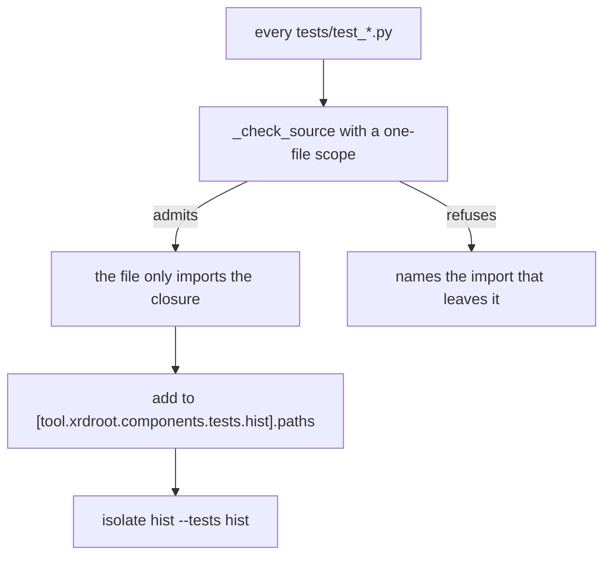

A component's isolation scope is a list in `pyproject.toml`, and the way to fill it is to ask the contract's own checker which test files it admits — not to guess from the imports you can see. Round 142 grew `hist`'s scope from **2 files / 11 tests to 15 / 418** that way, and found an export leak on the way.

## Ask the checker, don't guess

```bash
python - <<'EOF'
import pathlib, sys
sys.path.insert(0, ".")
from tools.component_contract.model import load_policy, ContractError
from tools.component_contract.testscope import TestScope, _files, _check_source
policy = load_policy(pathlib.Path("."))
support = ("tests/conftest.py", "tests/refmachine.py", "tests/rootrandom.py")
for path in sorted(pathlib.Path("tests").glob("test_*.py")):
    scope = TestScope(("hist",), (path.as_posix(),), support, "tests", ())
    try:
        _check_source(policy, scope, "probe", _files(policy, "probe", scope))
        print("admits", path.name)
    except ContractError as exc:
        pass
EOF
```

`_check_source` is what `components.py check` uses for a declared scope: it walks the test module's imports and refuses any that fall outside the scope's closure. 34 of the suite's files were admitted into a `hist`-only scope; fifteen were hist's (the others were core's and cppstd's, whose own scopes hold them).



## A top-level re-export must name the defining module

`Jagged` is **core's** class, defined in `src/xrdroot/jagged.py`, but `src/xrdroot/__init__.py`'s `_EXPORTS` reached it through `("tree", "Jagged")` — and `xrdroot.tree` is **io**. So `from xrdroot import Jagged` pulled the whole io package into the importing process, and four scope files died with `ImportError: Component isolation blocked xrdroot.file`. The export now names `("jagged", "Jagged")`; `xrdroot.tree` still re-exports the same class, so nothing else moved.

**Check an export's module, not just its object**: `xrdroot.Jagged is xrdroot.tree.Jagged` is true either way — the damage is in *which module gets imported*.

```python
assert xrdroot._EXPORTS["Jagged"] == ("jagged", "Jagged")
assert xrdroot.Jagged is importlib.import_module("xrdroot.jagged").Jagged
```

## Leave out what genuinely needs a higher component

`test_hist_stats.py`, `test_hist_slicing.py`, `test_function_formula.py`, `test_fit_root.py` and `test_graph_math.py` call `open_root`/`create` to read a fixture `.root` file. Those are io+hist integration tests: **a component test reads no file**. And `W0-273` is the checker's own limit — it admits a test helper only as a scope-named module, so `tests/support.py` cannot be declared and `test_hist_fill.py` waits on it.

## The number that says "completed"

Coverage **of the component, measured from its own scope alone**:

```bash
python -m pytest $(sed -n '/components.tests.hist/,/^\[/p' pyproject.toml | grep -o 'tests/test_[a-z0-9_]*\.py' | tr '\n' ' ') \
    --cov=xrdroot --cov-report=term-missing
```

For `hist` that read **43 modules, 2 003 unexercised statements** — `formula.select` 186, `fit.fraction` 106, `sparse` 102, `scatterplot` 101, `function.ndtri` 35 at zero, `formula.objects` 15 %, `graphmath` 15 %. A module the component owns and its own scope never runs is the work list.
