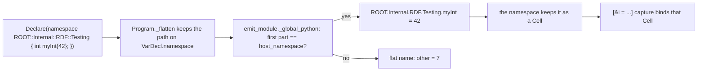

A namespace-scope variable declared inside the host's own namespace is emitted as that namespace's attribute — `ROOT.Internal.RDF.Testing.myInt = 42` — while one in any other namespace keeps a flat module-level name. `Program._flatten` now carries the namespace path on `VarDecl.namespace`, and `pycxx/emit_module._global_python` decides, because only the host's namespaces are Python objects anything reads back by path.

```python
from xrdroot import cint
print(cint.translate(
    "namespace ROOT::Internal::RDF::Testing { int myInt{42}; }\n"
    "namespace mine { int other{7}; }\n"
    "int plain = 3;\n", "d.C"))
```

```
ROOT.Internal.RDF.Testing.myInt = 42
other = 7
plain = 3
```

## Why it matters

A ROOT test declares a global with `gInterpreter->Declare("namespace ROOT::Internal::RDF::Testing { int myInt{42}; }")` and then reads it back as `ROOT::Internal::RDF::Testing::myInt` inside lambdas it passes to `Define`. Before this, the declaration emitted a bare `myInt = 42`, so the qualified read found nothing and the test refused at its first `Define`. The whole chain is now: emission → the namespace object stores each value as a `Cell` → a `[&i = qualified]` capture binds that cell (`pycxx/emit_funcs.py`'s `_shared_cell`), so two `Define`s share one storage.



## How to check

`pytest -q tests/test_pycint_namespaces.py` (four tests) and the program itself:

```bash
cd "$OUT/work/tree/dataframe/test" && PYTHONPATH=<worktree>/src python -m xrdroot run dataframe_compgraph.cxx
```

It reads `[  PASSED  ] 3 tests.`
