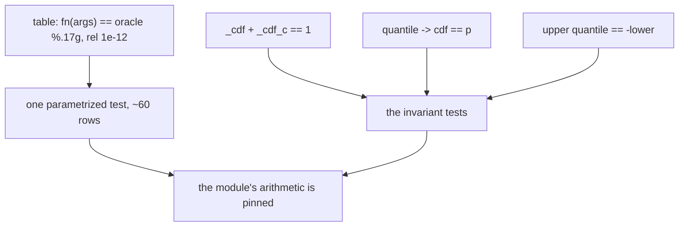

A module of pure maths is covered by two layers: a table of **the oracle's own values** for every function, and a handful of **invariants** that must hold across all of them. The table catches a wrong formula at the row that broke; the invariants catch a family that drifts apart in a way no single value shows. Between them, `xrdroot.function.rootmath` and `xrdroot.function.distributions` went from 0 % to 91 % and 83 % in two rounds.

## The invariants worth writing

- **Every lower tail and its upper twin sum to one**: `chisquared_cdf + chisquared_cdf_c == 1`, and the same for the thirteen other families. A pair that drifts apart is a plotting bug nobody would attribute to the maths.
- **A quantile put through its own cdf is the chance asked for** (`chisquared_cdf(chisquared_quantile(0.3, 4), 4) == 0.3`), and an upper quantile mirrors the lower (`gaussian_quantile_c(0.3, 1) == -gaussian_quantile(0.3, 1)`).
- **A density's support**: a gamma below its start and a log-normal below zero are 0.
- **A discrete family's masses sum to 1** over the integers: `sum(poisson_pdf(n, 2.5) for n in range(40)) == 1`.

Put each family's arguments in the parametrize tuple rather than deriving them inside the test - an `if/elif` chain that maps a family to its arity is unreadable and silently wrong when extended.

## Reading the names off ROOT

`ROOT.Math` carries the whole family under ROOT's own names (`gaussian_cdf`, `chisquared_quantile_c`, `crystalball_function`, `cyl_bessel_j`, `assoc_legendre`); a `_c` suffix is the **upper** tail; `TMath::Pi` is a **call** (`rm.Pi()`), not a constant; and `poisson_pdf`/`binomial_pdf` take an **unsigned integer** in the oracle, so pass `3` where the engine takes `3.0`. The full probe recipe is in `docs/instructions/read-a-whole-root-math-family-off-the-oracle-into-a.md`.

## Where the tolerance comes from

`rel=1e-12` with a comment: off ROOT's own machine glibc and Apple's libm round `erf`/`lgamma` in the last bits. Bit-exactness is only claimed when `tests/refmachine.ROOTS_MACHINE` is true. A table row that needs loosening is a question about the formula, not about the tolerance.
