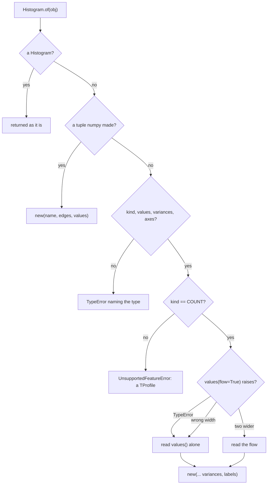

`Histogram.of` turns any histogram Python has into one this library writes, and it is on
the writer's path: `src/xrdroot/writer.py` asks `Histogram.recognises` and then
`Histogram.of` for every object handed to a `TFile`, so what `numpy.histogram`,
`numpy.histogram2d`, `numpy.histogramdd` or a `hist.Hist` gives back can be written into a
ROOT file. The plotting protocol it reads is five names — `kind`, `values`, `variances`,
`axes`, and a `flow` keyword — and a real object can vary every one of them, so the test
object should be a **stand-in** that breaks them one at a time rather than only the
installed library, which happens to do all five the convenient way.

## The four promises, and the stand-in for each

- **`values()` may take no `flow` argument.** The protocol allows the method without it,
  so the adapter must catch `TypeError` and read the inner bins. Without that arm a
  `boost_histogram` histogram raises in the middle of a `WriteObject`.
- **A flowed array must be two bins wider than the axes imply.** An object that answers the
  wrong width is lying, so the array is thrown away and the inner bins read — never
  reshaped to fit, which would put every bin one place along.
- **`kind` may be an enum member.** `hist.Kind.COUNT` is not the string `"COUNT"`;
  `getattr(kind, "value", kind)` reads both spellings, and `MEAN` (a `TProfile`) is refused
  in a full sentence rather than written as if its bins were counts.
- **There may be no `name` and no `label`.** `str(getattr(obj, what, None) or "")` gives an
  empty ROOT title; a plain `getattr` gives the string `"None"`, which is a title nothing
  can match later.

## What the stand-in catches that the real library does not

The installed `hist` does everything conveniently: its `values()` takes `flow`, its flow is
the right width, and its `kind` compares equal to `"COUNT"` through `str()`. A test that
uses only it passes while three quarters of the adapter is dead code — and the coverage
report says so, which is how this was found. Keep one test against the real package
(`pytest.importorskip("hist")`) for the labels and variances, and put the arms under a
stand-in of twenty lines.

## The refusals are part of the surface

`Histogram.of("not a histogram")` is a `TypeError` naming what it was handed, and a
two-dimensional `values` with one set of edges is *not* numpy's shape either. A tuple is
read only when `values.ndim == len(edges)` and every edge is one-dimensional; everything
else falls through to the protocol check, so a caller who passes numpy's output in the
wrong order is told, not silently given a histogram of nothing.
