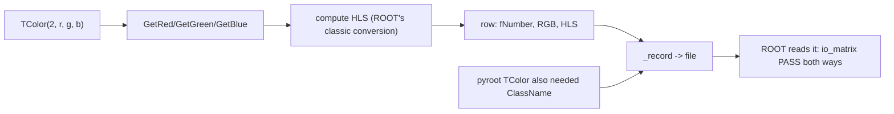

`TColor` streams HLS that its object does not store: the file carries `fHue`, `fLight` and `fSaturation` beside `fRed`/`fGreen`/`fBlue`, but pyroot's `TColor` answers only `GetRed/GetGreen/GetBlue` — the HLS has to be computed with the classic RGB→HLS conversion before the row can be built. The channels are also **32-bit floats**, so a test comparing them needs `abs=1e-6`, not `1e-9`.

```python
# src/xrdroot/writer.py, _colour_payload
red = float(value.GetRed()); green = float(value.GetGreen()); blue = float(value.GetBlue())
high, low = max(red, green, blue), min(red, green, blue)
light = (high + low) / 2.0
span = high - low
if not span:            saturation = 0.0
elif light <= 0.5:      saturation = span / (high + low)
else:                   saturation = span / (2.0 - high - low)
if not span:            hue = 0.0
elif high == red:       hue = 60.0 * ((green - blue) / span % 6.0)
elif high == green:     hue = 60.0 * ((blue - red) / span + 2.0)
else:                   hue = 60.0 * ((red - green) / span + 4.0)
```

## Why it needs every branch tested

Each of those four arms is reached by a different colour, and the coverage gate counts them: without a red-dominant, a green-dominant, a blue-dominant, a grey and a light-above-one-half case the writer sat at 99.75 %. They are now five parametrised cases in `tests/test_writer_tarray.py`.



## Two prerequisites, both repeats of a known pattern

1. pyroot's `TColor` had **no `ClassName`** — the fourth class in this session to need it (`TArray`, `TString`, `TColor`), because `TObject`'s lookup reaches for a dictionary these classes never fill.
2. The layout came from a donor + `tools/harvest_infos.py` (TColor v2, 3541594740, `TNamed` base, `fNumber`, seven floats), as the four-step recipe says.
