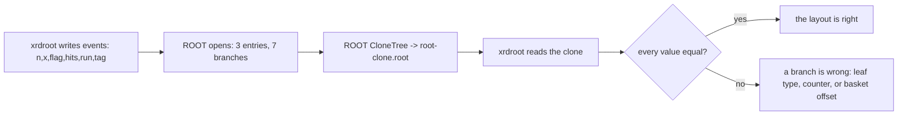

A TTree with every leaf shape xrdroot writes crosses a `.root` file and comes back unchanged — verified by ROOT, not by xrdroot reading its own file. `tools/io_matrix.py --tree` writes one tree (int, float, bool, fixed count of ints, a variable-length run, and text), has ROOT open it and `CloneTree` it into a second file, then reads that transcription back and compares every value.

```bash
PYTHONPATH=$PWD/src python -m tools.io_matrix --tree --oracle-prefix ~/.local/root-oracle \\
    --out ~/.cache/xrdroot-runs/io-tree-3
```

```json
{"root_read_ok": true, "entries": 3,
 "branches": ["n", "x", "flag", "hits", "nrun", "run", "tag"], "values_match": true}
```

## Why `CloneTree` is the check

ROOT's own reader is the only side that can say whether our layout is right; a file xrdroot writes and xrdroot reads proves nothing. `CloneTree` forces ROOT to walk every branch, so a wrong leaf type, a wrong counter branch or a wrong basket offset comes out as a different value in the clone — and the comparison at the end sees it.

`nrun` appearing in the branch list is expected: ROOT generates and keeps the counter branch for the variable-length `run` leaf, exactly as the writer lays it out (`x[nx]/F`).



## How to use it as a reference point

Every other object's I/O work should be able to say the same three things: ROOT opens the file, ROOT transcribes it, and the transcription still matches. For a class use `--classes`; for a tree use `--tree`. Both exit non-zero when the answer is no, so a harness can gate on them.
