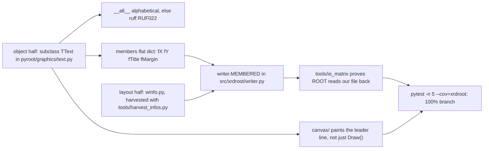

A class like `TAnnotation` is added in two halves: the Python object first, in an existing module beside its nearest kin, then the persistence and rendering that make it usable. `TAnnotation` is a `TText` whose label stands a margin off the point it annotates with a leader line back to it, so it belongs in `src/xrdroot/pyroot/graphics/text.py` and inherits `TText`'s members and drawing rather than starting from `Drawn`.



## The object half

```python
class TAnnotation(TText):
    classname = "TAnnotation"
    groups: ClassVar[tuple[str, ...]] = ("text",)
    fields: ClassVar[dict[str, type]] = {"X": float, "Y": float}

    def __init__(self, x=0.0, y=0.0, text=""):
        super().__init__(x, y, text)
        self.members.update(fMargin=0.02)
```

Check it before going further:

```bash
PYTHONPATH=$PWD/src python -c "from xrdroot.pyroot.graphics.text import TAnnotation; a = TAnnotation(1., 2., 'hi'); a.SetMargin(0.05); print(a.classname, a.GetMargin(), a.members)"
ruff check src/xrdroot/pyroot/graphics/text.py
```

`members` is the flat dict the writer serialises, so `fX`, `fY`, `fTitle` and `fMargin` must all appear there for the class to cross a file. A class that imports and answers `GetMargin` is **not** yet one ROOT can read back out of a `.root` file — `tools/io_matrix` is what proves that, and it is the step that tends to be skipped.
