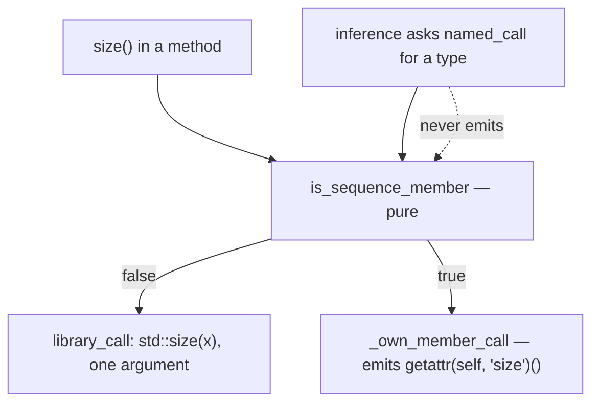

An unqualified call inside a method is looked up **in the class and its bases before the namespace**, so the translator must answer a member a base gives the object first — and the guard that does it must be split in two, a predicate that emits nothing and an emission that only runs where a call is written.

## Why the split, and not one function

`named_call` in `pycxx/emit_calls.py` is walked by **inference** as well as by emission: `auto v = f(x)` asks it what `f` returns. An arm that writes into the macro while inference is asking corrupts the value emitted afterwards — round 140 shipped `getattr(self, 'size')()` through `named_call` in one piece, all ten `io/json` tests passed, and `tests/test_pyroot_fitsparts.py::test_a_name_given_a_smart_pointer_is_a_cast_to_the_pointer` broke with `'tuple' object has no attribute 'GetNoElements'`. That is round 95's `_alias_call` lesson, twice.

So the guard is two things:

| piece | file | what it does |
|---|---|---|
| `is_sequence_member(func)` | `pycxx/emit_names.py` | **pure**: single-part name, in `SEQUENCE_MEMBERS`, in a non-static method, of a class whose base's last `::` part is in `SEQUENCE_BASES` |
| `_own_member_call(func, node)` | `pycxx/emit_calls.py` | **emits**: `getattr(self, '<name>')(<arguments>)` |



## The tables

```python
SEQUENCE_BASES = frozenset({"vector", "list", "deque", "forward_list", "array", "set", "multiset",
                            "map", "multimap", "unordered_set", "unordered_multiset",
                            "unordered_map", "unordered_multimap"})
SEQUENCE_MEMBERS = frozenset({"size", "empty", "clear", "push_back", "pop_back", "push_front",
                              "pop_front", "front", "back", "at", "resize", "reserve", "capacity",
                              "assign", "insert", "erase", "count", "find"})
```

A base's name comes from `library_bases()`, which spells it `std::vector<int>`'s head — compare its **last `::` part**, not the whole name (the first attempt compared the whole name and silently never matched).

## What it was worth, and how to check it

Ten roottest tests: `roottest/root/io/json/libJsonTestClasses-build` and its nine dependants, from `test_classes.h:756: std::size with 0 arguments` to `io/json` **11 PASS / 0 FAIL / 0 DIFF / 1 UNSUPPORTED**.

```bash
export PYTHONPATH=$PWD/src
.venv/bin/python -m pytest -q tests/test_cint_calls.py -k container_base
.venv/bin/python -m pytest -q tests/test_pyroot_fitsparts.py     # the acceptance check
.venv/bin/python -m tools.rootsuite run --root /tmp/rootsrc-6.40 --jobs 3 --only 'roottest/root/io/json/*'
```

The unit test must also reach the **no-class** arm (a free function calling `empty()`), which the coverage gate names as soon as the predicate has a second `return False`.
