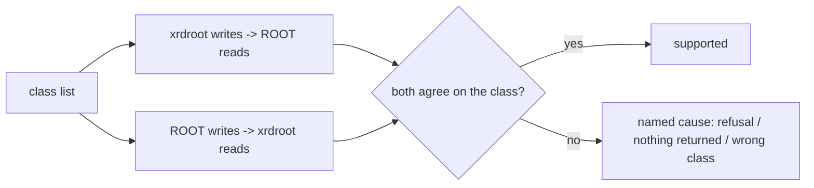

`tools/io_matrix.py` answers "does this class cross the file boundary" by asking ROOT itself: it writes each class with xrdroot and reads it back under the ROOT oracle, then the reverse, and compares the class name ROOT reports. Both directions must agree, so a writer refusal or a reader that returns nothing is a visible FAIL rather than a guess. First run on twelve base classes: **7 cross both ways**, and every one of the five failures is a single wall — `writer.py` accepts histograms, profiles, graphs and `TNamed`s and refuses the rest *by name*.

```bash
PYTHONPATH=$PWD/src python -m tools.io_matrix --oracle-prefix ~/.local/root-oracle \\
    --classes TNamed,TArrayI,TArrayD,TH1F,TH2F,TProfile,TGraph,TGraphErrors,\\
TLorentzVector,TMatrixD,TRandom3 --out ~/.cache/xrdroot-runs/io-matrix-1
```

```text
class               xrdroot->ROOT  ROOT->xrdroot  supported
TNamed                       PASS           PASS  True
TObjString                   PASS           PASS  True
TArrayI                      FAIL       saw None  False
TArrayD                      FAIL       saw None  False
TH1F / TH2F / TProfile       PASS           PASS  True
TGraph / TGraphErrors        PASS           PASS  True
TLorentzVector               FAIL           PASS  False
TMatrixD                     FAIL           PASS  False
TRandom3                     FAIL           PASS  False

7 of 12 classes cross the boundary both ways
```

## What the failures say

`UnsupportedFeatureError: a TArrayI is not something this writer puts in a ROOT file: it takes a Histogram, a Profile, ...` — the writer's accepted set is the whole cause. `TMatrixD` reads back as `TMatrixT<double>`, which is why the tool compares against `ALIASES` rather than the bare name.



## How to use it

Add names freely: `--classes` takes any list, and the JSON under `--out` keeps both directions' `why`. Grow it per library — `RIO` first (`TArray*`), then `Hist`, `Tree`, `GenVector` — and treat a class as supported only when this tool says so.
