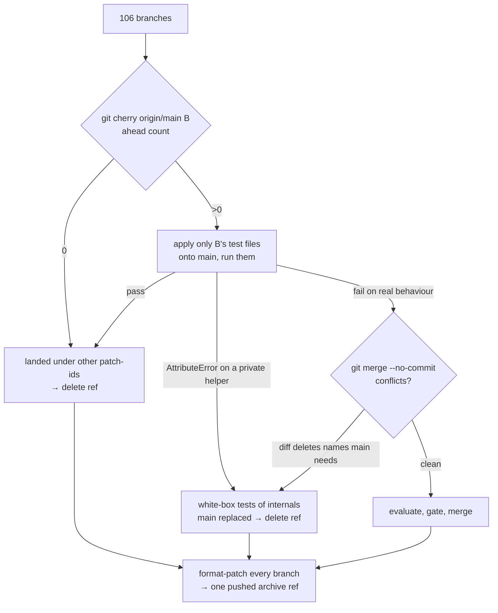

Auditing a few hundred branches needs a discriminator that survives a moved `main`: `git cherry` (patch-ids) splits real work from landed work, but `git diff main...branch` and `git apply --reverse --check` both stop being decisive once `main` has drifted, and test-name matching is only a hint. What settled it here was applying *only a branch's test files* onto `main` and running them: pass means the behaviour is there, and the failure text says whether the gap is real or the branch is white-box-coupled to internals `main` has replaced.



## The four passes, cheapest first

```bash
git cherry origin/main <branch> | grep -c '^+'        # commits patch-distinct from main
```

Zero means the branch's work is on `main` under other patch-ids — 70 of 106 branches here — and the ref can go. Non-zero needs a second look, because a long-lived loop re-lands the same work in later rounds under different context.

```bash
git worktree add -q --detach /scratch/w-t origin/main && cd /scratch/w-t
files=$(git diff --name-only origin/main...<branch> -- tests/ | tr '\n' ' ')
git checkout -q <branch> -- $files
PYTHONPATH=$PWD/src python -m pytest -q $files
```

Passing tests mean the branch is redundant. Failures of the form `AttributeError: module … has no attribute '_written_processes'` mean the branch's tests are coupled to internals `main` replaced, not that a feature is missing — check what `main` tests instead before calling it a gap.

```bash
git worktree add -q --detach /scratch/try origin/main && cd /scratch/try
git merge --no-commit --no-ff <branch>; git diff --name-only --diff-filter=U
```

A clean merge with real content is worth evaluating. A merge whose diff *removes* names `main` needs (`TDataType`, `TMethod`, the `kIs*` constants in `reflection.py`) is an older state of the same code: drop it, whatever its subject says.

## Archive before deleting, as one ref

```bash
for b in $(…); do git format-patch -q -o arch/$b origin/main..$b; done
# commit arch/ on a branch off origin/main and push it
```

63 patches from 35 branches went to `origin/archive/branches-20261123` in one commit. Deleting 75 branch refs then destroys nothing, and `git am` rebuilds any of them.

## What this found

Two clean merges that mattered — `QuasiRandomSobol`/`QuasiRandomNiederreiter`/`RandomMT`, which turned `other/math/mathmore/mathmore-testQuasiRandom` from UNSUPPORTED into PASS, and TAxis bin labels written in ROOT's `fLabels` layout — plus one perf branch for `TProfile2Poly` whose tests check the fast path against the slow one. Everything else was redundant, superseded, or white-box-coupled to internals that no longer exist.

One trap: when resolving a merge that shrinks `__all__`, the classes stay defined but stop being exported (`pyroot` builds the namespace from `__all__`), so a dozen unrelated tests fail with `ROOT has TRandom3; xrdroot.pyroot does not yet`. Union the list, then run the module's own tests.
