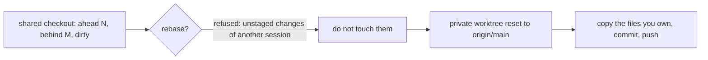

The shared checkout `/Users/rcurrie/src/xrdroot` is not a safe place to commit from: it can sit **hundreds of commits behind** `origin/main` while holding **dozens of modified files from other sessions**, so `git pull --rebase` refuses ("cannot pull with rebase: You have unstaged changes") and `git push` rejects the branch as non-fast-forward. Work belongs in a private worktree, and finished commits travel by cherry-pick or by copying the files into a clean worktree that is reset to `origin/main`.

```bash
# in the shared checkout, see why nothing can be pushed from it
git status -sb                      # ## main...origin/main [ahead 2, behind 160]
git pull --rebase -q origin main    # error: cannot pull with rebase: You have unstaged changes.

# the safe route, in a private worktree
cd ~/.cache/xrdroot-runs/wt-mf && git fetch -q origin && git reset -q --hard origin/main
cp <shared-checkout>/docs/<kind>/<name>.md docs/<kind>/ && git add docs && git commit -m "docs: ..."
git push origin HEAD:main
```



## Two things worth knowing

A cherry-pick can come back **empty** when the same paths already exist with the same content (`git cherry-pick` reports "how to handle commits that become empty"): check `git ls-tree -r --name-only origin/main <path>` before assuming a doc landed, because a doc that is only in the shared checkout is not on `main`.

Never `git add -A` in a checkout you share: `git status --porcelain | rg -v "^.. docs/"` is how you see whose work you were about to swallow. Here it listed about fifty `src/xrdroot/cppstd/*` and other files from another session.
