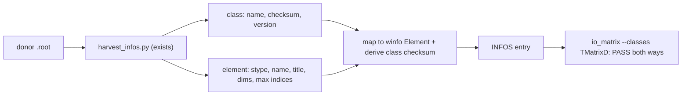

`tools/harvest_infos.py` now dumps a donor ROOT file's class descriptions — per class its name, checksum and class version, per element the streamer type, member name, title, array length and dimension, the five max indices and the type name — which is every field `winfo.INFOS` is built from. Two API details cost real time and are easy to hit again.

```bash
python -m tools.harvest_infos --out harvest.json /tmp/mm.root      # default oracle: ~/.local/root-oracle
```

```text
TMatrixT<double>      135074716    v4  [TMatrixTBase<double> BASE, fElements double*]
TMatrixTBase<double>  2333786657   v5  [TObject BASE, fNrows, fNcols, fRowLwb,
                                        fColLwb, fNelems, fNrowIndex, fTol]
```

## The two traps

1. **`TStreamerElement::GetType()`** is the streamer type. `GetStreamerType()` does not exist and does not compile — an hour goes on a call that reads as if it should.
2. **A cling-defined function is invisible to PyROOT.** `ProcessLine("void harvest(const char* p) { ... }")` then `ROOT.harvest(path)` raises `AttributeError: Failed to get attribute harvest from ROOT`: the facade caches its attribute list. Put the whole thing in a *statement block* with the path substituted in, as the tool does.

```python
# what works, from tools/harvest_infos.py
ROOT.gInterpreter.ProcessLine('{ TFile *f = TFile::Open("donor.root"); '
                             'TList *list = f->GetStreamerInfoList(); ... }')
```

## What is still missing upstream of `INFOS`

The harvester supplies the fields, but an entry also needs the class checksum `winfo` *derives* (`src/xrdroot/winfo.py:54`) and a mapping of each element into the 10-field `Element` tuple (`winfo.py:146`, with a real entry at `:200` — a base's checksum goes in max-index slot 1). Until both exist, `TMatrixD` and `TRandom3` have no entry and fail the write column of `python -m tools.io_matrix`.


