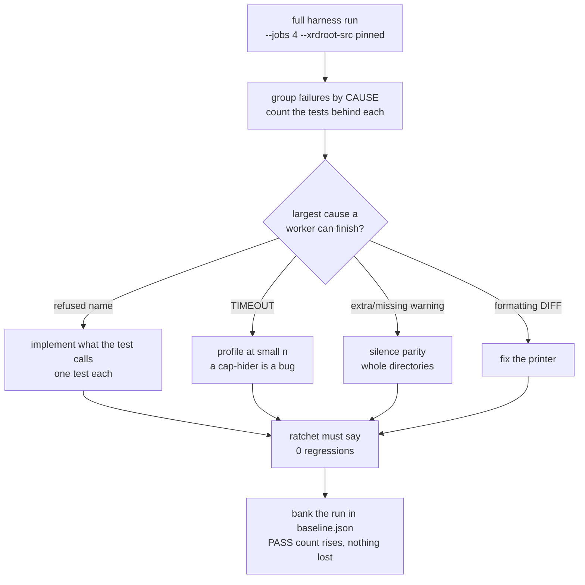

The parity work has two counters and every change must move one without lowering the other: the harness PASS count in `tools/rootsuite/baseline.json` (whose `ratchet` must print `0 regressions`) and the unit-test count from `pytest -q -n 2 --cov=xrdroot tests`. The loop's own task file, `.ralph/ROOT.md`, carries the operative copy of this under "Maximise the tests that pass"; this note is the project-level statement of the same rule.



## Rank by cause, then take the levers in order

```bash
python -m tools.rootsuite run --root ROOTSRC --jobs 4 --xrdroot-src $PWD/src --out R/run
jq '[.tests[]|select(.status=="PASS")]|length' R/run/results.json    # the counter
python -m tools.rootsuite ratchet R/run/results.json                 # must be 0 regressions
```

A cause blocking forty tests beats polish worth one. Measured levers: a refused name (`QuasiRandomSobol`/`RandomMT` → `mathmore-testQuasiRandom` UNSUPPORTED → PASS in one commit); a TIMEOUT (`execmanydirs` 162 s → 27 s once `TFile::Write` stopped checkpointing per subdirectory); warning parity (`ROOT::TIOFeatures` broke `SparseSelection`, `TVirtualIndex` broke `secondindex`); a formatting-only `.ref` DIFF; a stale cache (`CheckMissingDictionaries`, fixed by caching hits and never misses).

## What is not allowed

Never raise the 300 s timeout or a maintainability limit, never loosen an assertion, never add `# pragma: no cover`, never hand-keep a baseline PASS the run did not reproduce (that fails the ratchet on every later run). A test that passes only in one machine's order is not a PASS: `ClonesArrayEvo`, `forwardDeclAndFake` and `readGeo` differ inside a four-job run and pass alone — a harness defect, not a PASS.

## Measure before believing

Pin `--xrdroot-src`; re-run a TIMEOUT or DIFF alone (`--jobs 1 --only '<id>'`); build a roottest's `DEPENDS` fixture or its isolated answer means nothing; treat the five tests that read `root://eospublic.cern.ch` or a `TWebFile` as environmental. A worker's brief names its test id, its status today, and the command that proves the change — "improve X" is not a scope.
