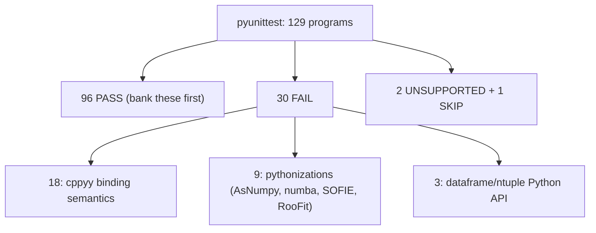

The `pyunittest` kind had never been measured in this loop; it now reads **96 PASS / 30 FAIL / 2 UNSUPPORTED / 1 SKIP of 129** in 129 s at `--jobs 4`, and its 30 failures fall into three causes rather than thirty. `tools/rootsuite/baseline.json` already carries rows for every kind (2820 of them), so the run was ratcheted against it: **0 regressions, and eight rows had gone stale FAIL -> PASS** — work from earlier sessions that was never banked.

```bash
python -m tools.rootsuite run --root "$HOME/src/.xrdroot-scratch/rootsrc" --kind pyunittest \
    --jobs 4 --xrdroot-src "$WT/src" --out "$OUT"
# {"pyunittest": {"PASS": 96, "FAIL": 30, "UNSUPPORTED": 2, "SKIP": 1}, "roottest": {"PASS": 3}}
jq -r '.tests[] | select(.status!="PASS") | "\(.status) \(.id)"' "$OUT/results.json"
```

## The three causes behind the 30

| Cause | Programs |
|---|---|
| cppyy's own binding semantics (`bindings/pyroot/cppyy/cppyy/test_*`) | 18 |
| pythonizations: `AsNumpy`/`MakeNumpy`, `numba`declare, SOFIE, `RooFit`, memory | 9 |
| dataframe/ntuple Python API (`DatasetSpec`, merge results, ntuple entry access) | 3 |

## What to do

Pick by cause, not by program. The eighteen cppyy modules are the biggest single cause and will take several rounds; the pythonization names are individually smaller and share `AsNumpy`. Bank what passes first — `tools/rootsuite/baseline.json` covers every kind (2820 rows), so this run could be compared with it directly and eight rows had gone stale the *good* way: `pyroot_array_numpy_views`, `pyroot_pyz_stl_set`, `pyroot_pyz_stl_vector`, `pyroot_root_no_implicit_cppyy`, `tpython/test_tpython`, `core/metacling/MetaClingTests`, `tmva/rbdt_xgboost`, `dataframe_snapshot_py` were FAIL and stand at PASS, +8 banked.


