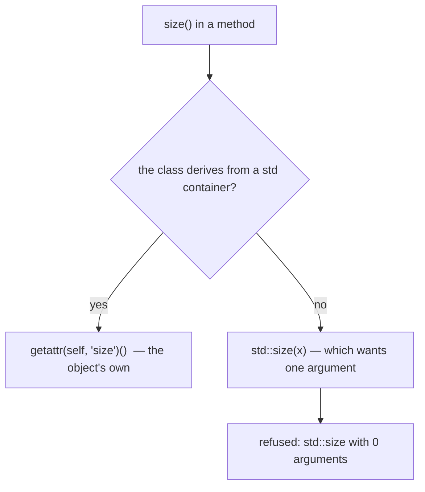

A whole-kind run is what turns a queue into a ranking, and it earned its keep here: 10 roottest tests hung on one name — `std::size with 0 arguments` — because a class deriving from `std::vector` calls `size()` and the translator resolves it to the **free** `std::size`. The obvious fix works for those ten and breaks one base-green test, which makes that test the next attempt's specification.

## The bucket, measured

`python -m tools.rootsuite run --root /tmp/rootsrc-6.40 --jobs 5 --kind roottest --xrdroot-src $PWD/src` gave, of 2173 tests:
**1358 PASS / 445 FAIL / 125 DIFF / 233 UNSUPPORTED / 10 SKIP / 2 TIMEOUT**, and the failure *reasons* rank as:

| tests | cause |
|---|---|
| 11 | `io/evolution/versions/AddVersion-*-*.ref` — the stale refs (`W0-253`), not a regression |
| **10** | `roottest/root/io/json/test_classes.h:756: std::size with 0 arguments` — `libJsonTestClasses-build` and its nine dependants |
| 7 | `needs the Python package jupyter` (an environment, not code) |
| 6 | `the branch 'TestVector…'` — the pair-vector branch, `W0-271` |
| 5 | `meta/evolution/execBaseClass_v2.ref` |

Ranking by *reason* rather than by test is the whole point: the ten are one defect, and the six are one feature.

## Why `size()` in a container's subclass is not `std::size`

```cpp
class TJsonEx1 : public std::vector<...> {
  void Print(Option_t *) const override { std::cout << "vector size = " << size() << std::endl; }
};
```

C++ looks in the class and its bases **before** the namespace, so `size()` is `vector::size()`. The translator's `named_call` falls through to `library_call` → `_special` → `_size`, which refuses a zero-argument call. A guard that answers `getattr(self, 'size')()` when the class derives from a standard container made `libJsonTestClasses-build` **and all nine dependants PASS** (measured: `io/json` 11 PASS / 0 FAIL / 0 DIFF / 1 UNSUPPORTED).



## And why it was reverted

With the guard in `named_call`, `tests/test_pyroot_fitsparts.py::test_a_name_given_a_smart_pointer_is_a_cast_to_the_pointer` failed with `'tuple' object has no attribute 'GetNoElements'` — and it **passes at the base** (checked in a scratch worktree, so it is not a stale row). The macro is

```cpp
using Up = std::unique_ptr<TVectorD>;
void alias() { auto v = Up(new TVectorD(3)); printf("%d\n", v->GetNoElements()); }
```

and the symptom is round 95's exactly: **an arm that emits while inference is asking for a type corrupts the value emitted later** — `named_call` is on both paths, and `self.arguments(node)` writes into the macro being built. So the guard must be **two things**: a *pure* predicate asked in `named_call` (does this class derive from a container, and is this name one of its members?) and the emission itself, done only where a value is emitted. `_alias_call` was moved for the same reason; a helper that returns a *string* has already emitted.

**The next round's scope, precisely**: `SEQUENCE_BASES`/`SEQUENCE_MEMBERS` in `pycxx/emit_names.py`, a pure `_is_sequence_member()` in `named_call`, the emitting `sequence_base_member()` in the value path, and `fitsparts`'s smart-alias test as the acceptance check — ten tests for one predicate.
