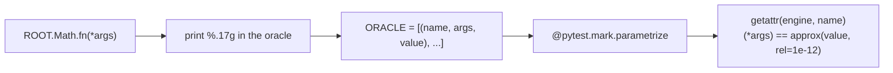

To check a whole family of `ROOT::Math` functions at once, print each one's value from the oracle with `%.17g` into a table and turn the table into a parametrized pytest — one test then covers a module's arithmetic, and a reader that rounds differently shows up at the row that broke. `xrdroot.function.rootmath` is the next module in this shape.



## The probe

```python
# ~/.local/root-oracle/bin/python
M = ROOT.Math
for label, fn, args in [
    ("normal_cdf(1)", M.normal_cdf, (1.0, 1.0, 0.0)),
    ("chisquared_quantile(0.3,4)", M.chisquared_quantile, (0.3, 4.0)),
    ("fdistribution_cdf(1,3,4)", M.fdistribution_cdf, (1.0, 3.0, 4.0, 0.0)),
]:
    print("%-28s %.17g" % (label, fn(*args)))     # 0.84134474606854293, 2.1946984214069833, ...
```

`ROOT.Math` carries the family under ROOT's own names — `normal_cdf`, `chisquared_cdf`, `gamma_quantile`, `tdistribution_*`, `beta_*`, `uniform_*`, `cauchy_*`, `breitwigner_*`, `lognormal_*`, `crystalball_*`, `exponential_*`, `poisson_*`, `binomial_*`, `landau_pdf`, `cyl_bessel_j/i`, `assoc_legendre` — and a `_c` suffix is the **upper** tail (`chisquared_cdf_c` = 1 − cdf).

## The traps

- **`poisson_pdf` and `binomial_pdf` take an unsigned integer**: `M.poisson_pdf(3, 2.5)` raises a cppyy signature error; pass `3`, not `3.0`.
- **`ROOT.TMath.CylBesselJ` does not exist**; the pair is `ROOT.Math.cyl_bessel_j` / `cyl_bessel_i`.
- Use a relative tolerance with a comment: off ROOT's machine glibc and Apple's libm round `erf`/`lgamma` in the last bits; bit-exactness is only claimed when `tests/refmachine.ROOTS_MACHINE` is true.

## One hazard in `invert`

`xrdroot/function/distributions.py`'s `invert` widens upward with `while cdf(high) < p: high = high * 2 + 1` and **no bound** — a cdf that never reaches `p` spins for ever (an 11-minute hang was observed). Feed it only rising cdfs; `W0-277` tracks the missing bound.
