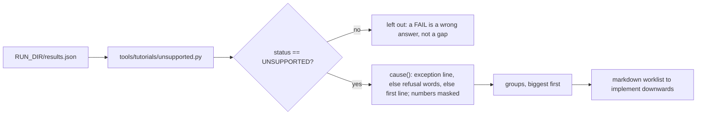

Getting the tutorials' `UNSUPPORTED` count down is a name-by-name grind, and the report below is the only way to see the list. Run it against a finished run's `results.json`; it groups refusals by cause rather than by tutorial, which is the number that matters.

```bash
python -m tools.tutorials unsupported ~/.cache/xrdroot-runs/tut-now/results.json
# # 88 refusals in 87 causes
# | 2 | `AttributeError: ROOT has RooLagrangianMorphFunc; xrdroot.pyroot does not yet` | ...
# | 1 | `AttributeError: ROOT has RDF.SaveGraph; xrdroot.pyroot does not yet` | ...
```



`tests/test_tools_tutorials_unsupported.py` covers it. **It is not on `main` yet**: the full `pytest … --cov=xrdroot` gate timed out three times on a loaded machine (2900 s, 600 s, 1699 s) while those tests alone run in 21 s, so it waits in the worktree `~/.cache/xrdroot-runs/wt-mf` (it was in `git stash@{0}` first — check `git stash list` there before rewriting it).

## Do not plan on families: 88 refusals are 87 causes

The biggest group is **2 tutorials**, so a budget of "+50 tutorials" means about **50 names**.

| kind | count | reaches PASS by |
|---|---|---|
| one missing class or function (`ROOT has X; xrdroot.pyroot does not yet`) | ~55 | implementing it |
| a refused ROOT 7 / tool class (`RNTupleProcessor`, `RFile`, `RLegend`, `TaskGroup`, `RNTupleImporter`) | 6 | a subsystem each |
| a data-level refusal (`TGeometry` streamer, `hprof` merge, RNTuple field shapes) | 5 | writing that layout |
| GUI/GL/web (`TControlBar` ×3, `TSlider` ×2, `TGL*` ×4, `TWebCanvas`) | 10 | nothing headless — label it |
| `libEGPythia8` absent from the oracle build | 1 | nothing — label it |

Start with the drawing primitives and small wrappers among the ~55: `docs/instructions/a-drawing-primitive-crosses-in-three-mechanical-steps.md` covers those end to end (donor `.root` → `tools/harvest_infos.py` → `INFOS` + `writer.MEMBERED` → `tools/io_matrix`), and `TAnnotation`, `TGraphQQ`, `TGraphTime` are all that shape.
