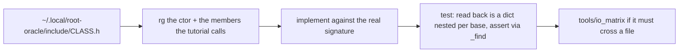

Implementing the four remaining refused classes starts from ROOT 6.40's own headers rather than from memory, and the signatures below were read out of `~/.local/root-oracle/include`. They are the API surface each tutorial calls, so the implementation can be written against them directly.

```bash
cd ~/.local/root-oracle/include
rg -n "TGraphTime\(|void AddPoint|void Paint" TGraphTime.h
rg -n "TLinearFitter\(|SetFormula|GetParameters" TLinearFitter.h
rg -n "TF1Convolution\(" TF1Convolution.h
rg -n "void Initialize|SetPseRan|TFoamIntegrand" TFoam.h
```



## The signatures, as ROOT declares them

| class | constructor / members that matter |
|---|---|
| `TGraphTime` | `TGraphTime()`, `TGraphTime(Int_t nsteps, Double_t xmin, Double_t ymin, Double_t xmax, Double_t ymax)`, `void Paint(Option_t*)`, `AddPoint(...)`, `TakeTime()` |
| `TLinearFitter` | `TLinearFitter()`, `TLinearFitter(Int_t ndim)`, `TLinearFitter(Int_t ndim, const char *formula, Option_t *opt="D")`, `SetFormula`, `AddPoint`, `Eval`, `Fit`, `GetParameters` |
| `TF1Convolution` | `TF1Convolution()`, `(TF1*, TF1*, Bool_t useFFT=true)`, `(TF1*, TF1*, Double_t xmin, Double_t xmax, Bool_t)`, `(TString formula, Double_t xmin=1., Double_t xmax=0., Bool_t)`, `void SetRange(Double_t a, Double_t b)` |
| `TFoam` | `void Initialize()`, `void Initialize(TRandom*, TFoamIntegrand*)`, `void SetPseRan(TRandom*)`, `GetX()`, `Density()`, `MakeGrid()` |

## Why read the header first

`TAnnotation` cost two wrong turns because its shape was guessed: it was written as a `TText` with a `SetMargin`, and the oracle compiler rejected both — `TAnnotation.h:19` says `class TAnnotation : public TLatex`, ctor `(x, y, z, text)`, one member `fZ`, no `SetMargin`.

Also: a class with no Python wrapper of ours reads back from a `.root` file as a **plain dict nested per base** (`{'TLatex': {'TText': {'TNamed': {'fTitle': …}}}, 'fZ': 0.5}`), so assertions go through `_find(members, key)` in `tests/test_writer_tarray.py`, never `.classname`.
