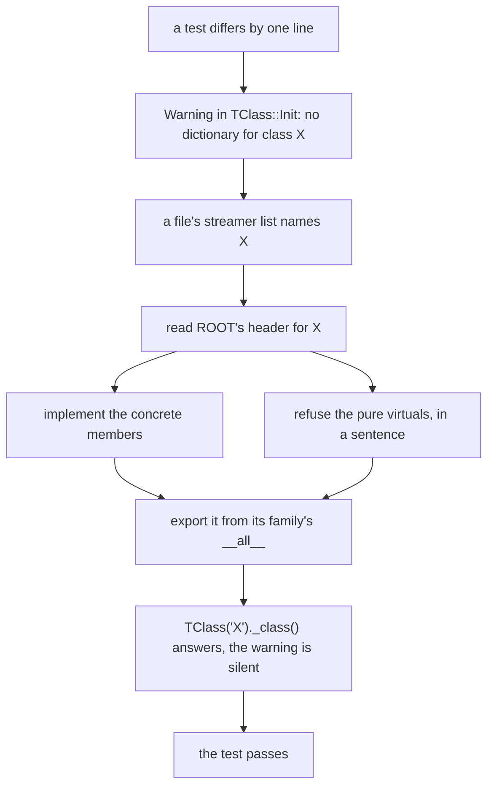

When a test differs by one line that reads `Warning in <TClass::Init>: no dictionary for class X is available`, the fix is not to silence the warning: a class the namespace provides **has** a dictionary, so write `X` from ROOT's own header. That is what closed `io/webfile/CloseTWebFile` (`TGeoPatternFinder`) after round 126 did the same for `TArray`.

## The recipe

1. **The warning names the class, and the file says why**: a ROOT file's streamer list names every class it holds, so `grep -n 'no dictionary for class' run.log` gives you `X` and the ref gives you the line it should not have.
2. **Read ROOT's header, not your memory**: `geom/geom/inc/TGeoPatternFinder.h` gave the members (`fStep`, `fStart`, `fEnd`, `fNdivisions`, `fDivIndex`, `fVolume`), the flags (`kPatternReflected = BIT(14)`, `kPatternSpacedOut = BIT(15)`), the constants (`GetByteCount()` 36, `GetDivAxis()` 1) and the arithmetic (`SetRange`'s `fEnd = fStart + ndivisions * step`).
3. **Implement the concrete members as the header states them**; where a member's behaviour is not stated, say what ROOT's default is (`FindNode` returns `nullptr`, `IsOnBoundary` returns `kFALSE`) rather than inventing one.
4. **Refuse the pure virtuals by name.** ROOT's `TGeoPatternFinder::CreateMatrix` and `MakeCopy` are `= 0`: only the axis finder that made a division knows which axis it divides. An `UnsupportedFeatureError` naming them is honest where a made-up matrix would not be:
   ```python
   raise UnsupportedFeatureError(
       "TGeoPatternFinder::CreateMatrix is a pure virtual of ROOT's base class: the matrix of a "
       "division belongs to the axis finder that made it (TGeoPatternX, TGeoPatternY or "
       "TGeoPatternZ). Use one of those, which knows which axis it divides."
   )
   ```
5. **Export it** where its family lives (`pyroot/geom/__init__.py`'s `__all__`) and add a unit test that reaches **every** accessor — the coverage gate names any line a test never touches, and a class written only to be named has no other exercise.



## Two checks worth keeping

**Measure the other failure at the base before claiming it.** This round's gate had one red test,
`tests/test_root_wtree.py::test_a_written_tree_describes_its_classes_exactly_as_the_donors_do`, on
`TTree::fAutoSave`'s title text. A scratch worktree at `origin/main` (`git worktree add -d $B origin/main`,
then the one test) says whether it is yours; here it failed at the base, so it became `W0-272` rather than
a chase.

**The independent measurements prove the class costs nothing**: `io/geo` measured whole at the tip was
20 / 0 / 1 / 0 of 21, unchanged, and `io/webfile` went FAIL → PASS.
