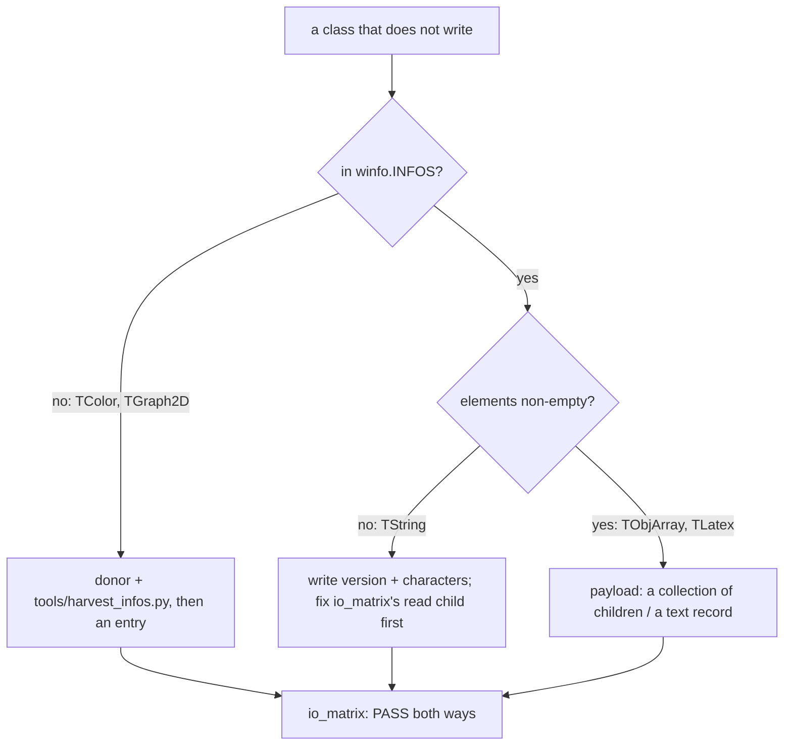

The five write gaps left in the 18-class sample are **two different jobs**, and telling them apart first saves a session: `TColor` and `TGraph2D` have no `winfo.INFOS` entry at all and need a donor harvested before any payload is possible, while `TObjArray`, `TLatex` and `TString` have a layout and need a payload (and, for `TString`, a fix in the measuring tool first).

```bash
PYTHONPATH=$PWD/src python - <<'PY'
from xrdroot.winfo import INFOS
for n in ("TString", "TObjArray", "TLatex", "TColor", "TGraph2D"):
    e = INFOS.get(n)
    print(n, "IN" if e else "MISSING", (e[0], e[1], [(x[0], x[1], x[8]) for x in e[2]]) if e else "")
PY
```

```text
TString    IN  (95257, 2, [])                    # a layout with NO elements
TObjArray  IN  (TSeqCollection BASE, fLowerBound, fLast)
TLatex     IN  (TText BASE, TAttLine BASE, fLimitFactorSize, fOriginSize)
TColor     MISSING
TGraph2D   MISSING
```

## The `TString` trap

A `TString` key is a version word then the characters, and `INFOS["TString"]`'s **empty element list** makes the table look ready when it is not. Writing it that way is a one-line payload; the measurement then fails with

```text
AttributeError: 'str' object has no attribute 'ClassName'
```

because xrdroot reads a `TString` key back as a Python `str` — correctly — and `tools/io_matrix.py`'s read child assumes the object can name itself. That is the same shape as the array case already handled in the child: report the requested class when the reader hands back values.



## Order of work

1. Fix `tools/io_matrix.py`'s read child to tolerate a values-typed read (arrays already do) — that unblocks judging `TString`.
2. `TString`, then `TObjArray`, then `TLatex` — each a payload over an existing layout.
3. `TColor` and `TGraph2D` last: donor, harvest, entry, payload.
