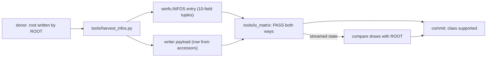

Adding a class to xrdroot's file I/O is now a repeatable four-step recipe, proved twice — `TMatrixD` and `TRandom3` both went from "no layout" to ROOT reading our file in one pass each. Follow it in this order and the class lands; skip step 4 and you ship a file that reads back wrong.

```bash
# 1. a donor: write the class with ROOT
~/.local/root-oracle/bin/python -c "
import ROOT
f = ROOT.TFile.Open('/tmp/donor.root', 'RECREATE')
ROOT.TMatrixD(2, 2).Write('m'); f.Close()"

# 2. harvest every class and element the donor describes
python -m tools.harvest_infos --out harvest.json /tmp/donor.root

# 3. put the classes in src/xrdroot/winfo.py (INFOS.update({...})) and give the writer a
#    payload in src/xrdroot/writer.py (see _matrix_payload / _random_payload)

# 4. prove both directions against ROOT - this is the gate, not a formality
python -m tools.io_matrix --oracle-prefix ~/.local/root-oracle --classes TMatrixD
```

## What each step actually costs

| step | what to know |
|---|---|
| donor | any object of the class, written and closed; the file carries the descriptions |
| harvest | gives per class checksum/version and per element stype, name, title, array length, dim, the five max indices and the type name |
| `INFOS` | 10-field tuples; a base's checksum goes in max-index slot 1; a fixed array carries its length in the declared slot — `('TStreamerBasicType', 'fMt', '', 33, 4, 624, 0, ...)` — or `_number_element` refuses the row |
| payload | build the row from public accessors; if the object keeps state privately, check for an existing export (`_engine_export`) before adding one |
| `io_matrix` | PASS in *both* columns; if the write column fails only under `WriteObject`, it is `pyroot` handing the writer a *different* object (an unwrapped engine, a proxy), not a layout bug |
| semantics | where the class carries a stream (a generator), compare actual draws — a wrong word order still opens cleanly |



## Why it is worth writing down

The two classes that took a session each failed on *different* things — `TMatrixD` on a missing array length, `TRandom3` on a `pyroot` object identity — and neither failure looked like the other. The recipe's value is that step 4 catches both kinds, and the "semantics" row catches the third kind (a file that opens with the wrong numbers) that no structural check can see.
