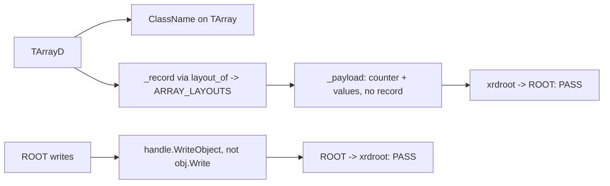

The `TArray` family now crosses the file boundary both ways — `TArrayC/S/I/L64/F/D` write from xrdroot and read back under ROOT, and ROOT's files read back here — and the base set stands at **9 of 12** classes. The three still failing are `TLorentzVector`, `TMatrixD` and `TRandom3`, all refused by the writer's accepted set rather than by any layout problem.

```
class               xrdroot->ROOT  ROOT->xrdroot  supported
TNamed / TObjString / TH1F / TH2F / TProfile
TGraph / TGraphErrors                     PASS           PASS  True
TArrayI / TArrayD                         PASS           PASS  True
TLorentzVector                            FAIL           PASS  False
TMatrixD                                  FAIL           PASS  False
TRandom3                                  FAIL           PASS  False
                                        9 of 12 cross the boundary both ways
```

## What made the arrays work

Three things, each needed and each small:

1. `ClassName` on `TArray` (`src/xrdroot/pyroot/vectors.py`) — `TObject`'s version reaches for a class dictionary the arrays never fill.
2. `_record` resolving layouts through `layout_of`, so `winfo.ARRAY_LAYOUTS` is reachable (`INFOS` has no `TArray`), and `_payload` writing the class's counter and values **with no record round them**, exactly as `TArray::Streamer` does.
3. The matrix's child writing through the file: under PyROOT `obj.Write("obj")` goes to `gDirectory`, which is *not* the file just opened, so ROOT's file came out with **no keys** and the tool reported a reader failure that did not exist.



## The lesson worth keeping

Two rounds went to a "reader gap" that was a **tool** gap: `obj.Write` silently writing nowhere produced an empty file, and an empty file read by a correct reader returns nothing. Check the *other side's output* — `GetListOfKeys()` was empty — before believing the reader is at fault.

## Next, in order

`TLorentzVector` (`fP` a `TVector3` + `fE`), `TMatrixT<double>` (rows, columns, an `TArrayD`), `TRandom3` (its Mersenne state) — then grow the class list per library and drive the matrix to 100 % for each.
