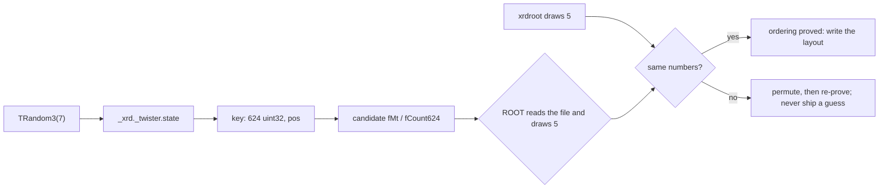

`TRandom3`'s engine state is reachable today without touching `pyroot`: `ROOT.TRandom3(7)._xrd._twister.state` is a dict `{'bit_generator': 'MT19937', 'state': {'key': [624 uint32], 'pos': int}}` — the 624 words ROOT streams as `fMt` and the count it streams as `fCount624`. What is *not* yet known is whether numpy's `key` order equals ROOT's `fMt` order, and that must be proved against an oracle file rather than assumed.

```python
import xrdroot.pyroot as ROOT
state = ROOT.TRandom3(7)._xrd._twister.state
state["state"]["pos"]          # 624 — a freshly seeded engine has drawn nothing
state["state"]["key"][:3]      # [7, 4097098180, 3572822661]
```

## How to prove the ordering

1. Write a `TRandom3` with xrdroot once the layout exists, `CloneTree`-style style is not applicable, so: have ROOT open the file, read the object, and draw five numbers.
2. Draw the same five from xrdroot's object.
3. Equal streams means the ordering is right. Different streams with equal lengths means the words are the same state in another order — permute, do not guess.



## Why not just write it

A wrong word order still produces a valid file that reads back a *different stream* — no error, no diff in structure, just wrong numbers forever after. That is the failure mode `winfo`'s verbatim emission makes easiest to hit and hardest to see, so the five-number comparison is the acceptance, not the file opening cleanly.
