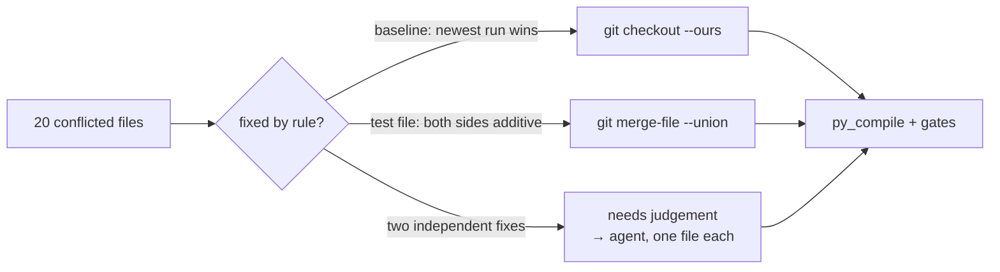

Triage a big merge before you delegate it: the conflicts whose answer is fixed by rule take minutes with `git checkout --ours` and `git merge-file --union`, and only the ones needing judgement should reach an agent. On a 20-file merge this halved the delegated work (20 → 10) while the agents were still starting, and the 9 test files it resolved mechanically keep both sides' tests by construction.

## The two mechanical cases

A file whose correct answer is "the newer measured one" — here `tools/rootsuite/baseline.json`, the harness baseline, which only a real run may write:

```bash
git checkout --ours tools/rootsuite/baseline.json && git add tools/rootsuite/baseline.json
```

Test files that each side added tests to. The index stages three versions of every conflicted file, so the union is one command per file:

```bash
git show :2:$f > o.py && git show :1:$f > b.py && git show :3:$f > t.py
git merge-file --union -p o.py b.py t.py > $f && git add $f
/Users/rcurrie/src/xrdroot/.venv/bin/python -m py_compile $f   # proves it still parses
```

`:1:` is the merge base, `:2:` ours, `:3:` theirs. Union is right only where both sides are purely additive — a test file is; a source file is not, because union duplicates definitions and leaves two answers to one question.

## What is left is the real work



## Never trust a delegated report alone

The integrator's report said all six gates were green; the two judge agents that were supposed to check it returned `null`. Run the gates yourself on the merged tree before pushing — `pytest -q -n 4 --cov=xrdroot tests`, ruff, mypy, `tools/maintainability.py check`, `tools/components.py check`, `mkdocs build --strict` — and grep the tree for conflict markers and for stray build outputs (`*.xrdlib` and friends) that a branch committed with `git add -A`.
