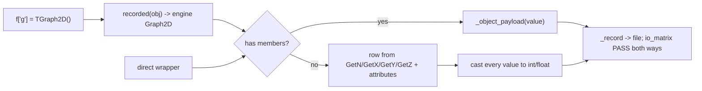

Two routes reach the writer for the same class — the pyroot wrapper and the engine behind it (`unwrap(obj)`) — and a payload must serve both. For `TGraph2D` that means one row shape: the engine's own `members` are handed straight to `_object_payload`, while the wrapper answers through accessors. Casting every value to a plain `int` or `float` is not tidiness: numpy scalars reaching the record's `struct` packing raise `struct.error: required argument is not an integer`.

```python
# src/xrdroot/writer.py, _graph2d_payload
members = getattr(value, "members", None)
if members is not None:
    return _object_payload(value)          # the engine: it already has its members
count = int(value.GetN())
row = {
    "fLineColor": int(value.GetLineColor()), ...        # the attribute bases
    "fNpoints": count, "fNpx": int(value.GetNpx()), ...
    "fX": [float(item) for item in value.GetX()], ...   # coordinates, not the array
}
```

## Two API facts found on the way

1. pyroot's `TGraph2D` has **no `GetMaxIter`** — the member falls back to ROOT's default 100000 via `getattr(..., lambda: 100000)()`.
2. `GetX()` takes **no index**: it answers the whole array, so a per-point `GetX(i)` loop is the wrong shape.



## Why the coverage gate forced the second test

One route tested leaves the other's lines uncovered, so the writer sat at 99.75 %. `tests/test_writer_tarray.py` now has a test per route, which is what took the gate back to 100.00 % — and those two tests are also the only guard that both objects keep producing the same record.
